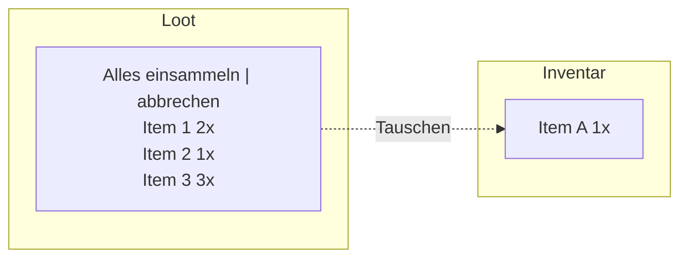

Heute habe ich mich an Loot und Inventar gesetzt. Schon am Anfang ist mir dabei ein Fehler aufgefallen: Ich hatte die KI nicht wirklich gesteuert. Bei der Demo dachte ich, sie würde schon wissen, was sie tut, und habe ihr zu viel Kontrolle über den Code gelassen, ohne selbst genau genug hinzuschauen.

Die `World.cs` war inzwischen für ziemlich viel zuständig: Gegner spawnen, Animationen abspielen, den Spieler steuern und Eingaben verarbeiten. Als ich dann noch die UI für das Inventar einbauen wollte, landete auch die erst einmal in dieser großen Klasse. Nach mehreren Versuchen war das Inventar trotzdem nicht sichtbar.

Im normalen Godot-Projekt würde ich dafür eine eigene 2D-Szene anlegen und ein Script schreiben, das sich nur um diese Szene kümmert. Also habe ich der KI den Hinweis gegeben, das Loot-Fenster und das Inventar als eigene Szenen aufzubauen. Das war der Wendepunkt: Die UI bekam eigene Scripts, während die `World.cs` die Menüs miteinander verbindet und den Ablauf in der Spielwelt steuert. Danach ließ sich das Verhalten viel besser umsetzen.

Zum Looten können Gegner eine Beutekiste fallen lassen. Wenn ich in ihrer Nähe die Leertaste drücke, öffnet sich das Loot-Fenster. Dort kann ich alles einsammeln, abbrechen oder einzelne Gegenstände auswählen. Ich kann auch zum Inventar wechseln und Gegenstände zwischen dem Loot und meinem Inventar hin- und herlegen. Gleiche Gegenstände werden dabei als ein Eintrag mit einer Anzahl angezeigt.

Rückblickend war nicht unbedingt das verwendete Modell – GPT-6 Luna mit Reasoning-Level „mittel“ – der entscheidende Punkt. Viel wichtiger war, dass ich konkreter beschrieben habe, wie die UI in Godot aufgebaut werden soll. Der Hinweis auf eigene Szenen und getrennte Scripts hat geholfen, die Aufgabe in kleinere, verständlichere Teile aufzuteilen.

# Tasten und Layout

Bei der Umsetzung musste ich mir auch Gedanken über die Steuerung machen. Ich möchte das Spiel zunächst komplett mit der Tastatur spielen und später möglichst auch mit einem Xbox-Controller. Die aktuelle Steuerung funktioniert mit der Tastatur; den Controller habe ich bei der Tastenwahl erst einmal als Ziel im Hinterkopf behalten.

Auf der Tastatur habe ich deshalb die Taste „J“ als Bestätigung ausgewählt und „K“ zum Abbrechen beziehungsweise Wegwerfen vorgesehen. Mit „W“ und „S“ bewege ich die Auswahl innerhalb des Loot-Fensters oder des Inventars nach oben und unten. Mit „A“ und „D“ wechsle ich zwischen den Bereichen.

Ein typisches Grid-Layout wollte ich zunächst nicht umsetzen. Für den Anfang sollte eine einfache Liste reichen. Im Grunde dachte ich an Folgendes:

Das Verhalten war gar nicht so leicht zu erklären. Am besten hat es funktioniert, als ich den Aufbau mit zwei Spalten in Excel verglichen habe: Die erste Spalte ist in Bereiche aufgeteilt. Oben wechselt man zwischen den Loot-Aktionen, unten wählt man die Gegenstände aus. Dazu kommt die zweite Spalte für das Inventar. Mit diesem Bild konnte ich der KI besser beschreiben, wie die Auswahl zwischen den Bereichen funktionieren soll.

Zum Schluss mussten die Gegenstände noch nach Namen gruppiert werden, damit gleiche Items als Stapel mit ihrer Anzahl erscheinen. Für die Aufbewahrung während des Spiels gibt es eine `Session`-Klasse. Das ist eine eigene Klasse im Projekt, die von Godots `Node` erbt. Ihr Inventar ist aktuell eine statische Liste: Es bleibt beim Wechsel zwischen Stadt und Arena erhalten, wird aber noch nicht dauerhaft auf der Festplatte gespeichert.

# Fazit

Nach den ersten Tagen merke ich schon, was passiert, wenn ich den Code aus der Hand gebe und nicht genau darauf achte, wie er aufgebaut ist. Die große `World.cs` hat die Arbeit an der UI erschwert. Mit eigenen Szenen und Scripts wurde das Ergebnis übersichtlicher und das Verhalten ließ sich besser umsetzen.

Immerhin kann ich jetzt zwischen Kampfszene und Stadt wechseln, Gegner besiegen und ihren Loot einsammeln. Es fehlt noch ein Ziel im Spiel: Wozu mache ich das Ganze, und was bringt mir der Loot?

Das sind spätere Fragen. Im Moment denke ich darüber nach, das Projekt mit klareren Regeln und Skills sauber neu anzufangen und mich langsam mehr um die Grafik zu kümmern. Ich merke schon, dass das Aussehen eine wichtige Rolle für den Spielspaß spielt. Vielleicht gehe ich das als Nächstes an.
